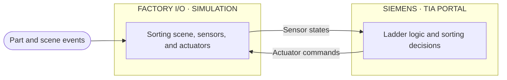

Sorting Level 1 | Factory I/O + Siemens TIA Portal

> **Level 1 PLC project** — a hands-on exercise for building and documenting a sorting task with Factory I/O and Siemens TIA Portal.

## Project overview

This project is based on the **Sorting_Level_1** Factory I/O scene. The goal is to connect the scene to a Siemens PLC and develop ladder logic for the sorting process. The exact sensor conditions, sorting rules, PLC addresses, and sequence should be documented from the scene and TIA Portal project.

## Repository contents

| Path | Purpose |
|---|---|
| `Sorting_Level_1.factoryio` | Factory I/O scene |
| `Sorting_Level_1/` | Siemens TIA Portal project files |
| `photo` | Project image |
| `README.md` | Project guide |

## Requirements

- Factory I/O
- Siemens TIA Portal
- Compatible Siemens PLC or PLCSIM setup
- Factory I/O driver configured for the selected PLC/simulator
- Windows 10/11 (64-bit)

Record the software versions, PLC model, and driver used for this project once confirmed from the working setup.

## Getting started

1. Open the TIA Portal project in `Sorting_Level_1/`.
2. Compile the PLC program and load it into the PLC or PLCSIM.
3. Set the PLC to **RUN**.
4. Open `Sorting_Level_1.factoryio` in Factory I/O.
5. Select and configure the matching Siemens driver, then connect.
6. Start the Factory I/O scene and observe the sorting sequence.

Confirm that the Factory I/O driver tags match the PLC tag table before running the simulation.

## System at a glance

Each PLC scan reads scene inputs, evaluates the sorting logic, and updates outputs. Factory I/O then applies those commands and reports the resulting sensor states.

## I/O map

Fill this table from the actual Factory I/O scene and TIA Portal tag table. Do not rely on example addresses.

| Signal | Function | Factory I/O tag | PLC address | Type |
|---|---|---|---|---|
| `<input>` | `<sensor or operator command>` | `<tag>` | `<address>` | BOOL |
| `<output>` | `<sorting actuator>` | `<tag>` | `<address>` | BOOL |

## Sorting sequence

Document the actual conditions and destination rules after checking the scene and PLC logic.

| Step | Action / condition | PLC response |
|---|---|---|
| 1 | `<part detected / cycle start>` | `<logic response>` |
| 2 | `<sorting condition identified>` | `<select destination>` |
| 3 | `<actuator operates>` | `<divert or route part>` |
| 4 | `<part clears / cycle completes>` | `<return to ready state>` |

## PLC program

Add the relevant network or block names and screenshots from TIA Portal here. Include the role of each block and the tags used for the scene interface.

| Block / table | Purpose |
|---|---|
| `OB1` | Main cyclic program, if used |
| `<FC/FB>` | `<sorting sequence or device control>` |
| `<PLC tag table>` | Factory I/O input/output mapping |

## Troubleshooting

| Problem | Check |
|---|---|
| Driver does not connect | PLC RUN state, selected driver, simulator instance, and interface |
| Sensors do not change in the PLC | Factory I/O tag mapping and PLC input addresses |
| Sorting actuator does not operate | Output mapping, program conditions, and actuator tag |
| Part is sent to the wrong route | Sorting condition, sensor state, and destination output mapping |

## Learning outcomes

- Identify sensors and actuators in a Factory I/O sorting scene.
- Map Factory I/O signals to PLC tags and addresses.
- Implement and follow a basic sorting sequence in ladder logic.
- Connect a simulated PLC to Factory I/O and diagnose signal mapping issues.

## Safety note

This is a simulation and learning exercise, not a validated production control design. Real equipment requires an appropriate risk assessment, guarding, safety circuits, and commissioning.
